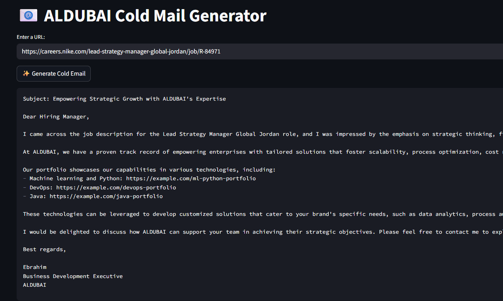
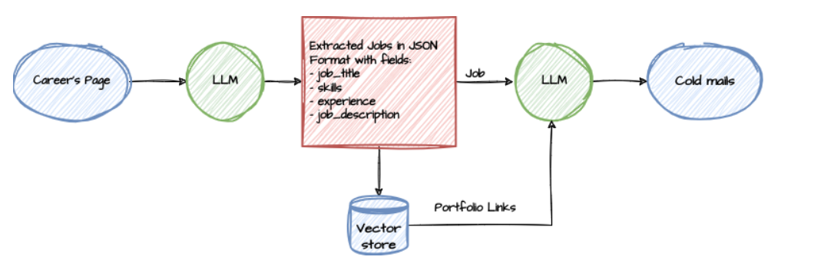

# 📧 ALDUBAI Cold Email Generator

An AI-powered cold email generator for service-based consulting companies, built with **Groq**, **LangChain**, **ChromaDB**, and **Streamlit**.

It scrapes job postings from a company's careers page, extracts the role requirements using an LLM, matches relevant portfolio links from a vector database, and generates a personalized cold email reaching out to the hiring company.

## 💡 The Scenario

- **Nike** posts a job for a Principal Software Engineer — they need to spend time and resources on hiring, onboarding, and training.
- **ALDUBAI** is an AI & Software Consulting company that can provide ready-to-go dedicated engineers.
- **Ebrahim**, Business Development Executive at ALDUBAI, uses this tool to automatically generate a personalized cold email pitching ALDUBAI's services — complete with relevant portfolio links matched to Nike's required skills.



## 🏗️ Architecture



## 🛠️ Tech Stack

- **LangChain** — Orchestrates the LLM workflow and prompt templates
- **Groq** — Fast LLM inference (using `llama-3.3-70b-versatile`)
- **ChromaDB** — Vector database for semantic search over the portfolio
- **Streamlit** — Web UI
- **Pandas** — Data handling for the portfolio CSV
- **BeautifulSoup / WebBaseLoader** — Job posting scraping

## ⚙️ How It Works

1. **Scrape** — User pastes a job posting URL into the Streamlit app
2. **Extract** — LangChain + Groq extract the job's role, skills, experience, and description as structured JSON
3. **Match** — The required skills are queried against a ChromaDB vector store containing portfolio tech stacks
4. **Generate** — A personalized cold email is generated, pitching ALDUBAI's services and including the most relevant portfolio links

## 🚀 Setup

### 1. Get a Groq API Key
Sign up and grab a free API key from [https://console.groq.com/keys](https://console.groq.com/keys).

### 2. Configure environment variables
Copy the example env file and add your key:
```bash
cp app/.env.example app/.env
```
Then open `app/.env` and replace `your_groq_api_key_here` with your actual key.

### 3. Install dependencies
```bash
pip install -r requirements.txt
```

### 4. Run the app
```bash
streamlit run app/main.py
```

The app will open in your browser at `http://localhost:8501`.

## 📁 Project Structure

```
project-genai-cold-email-generator/
├── app/
│   ├── main.py              # Streamlit UI
│   ├── chains.py            # LangChain prompts & LLM logic
│   ├── portfolio.py         # ChromaDB portfolio management
│   ├── utils.py             # Text cleaning helpers
│   ├── .env.example         # Template for environment variables
│   └── resource/
│       └── my_portfolio.csv # Sample portfolio data
├── imgs/                    # Architecture diagram & screenshots
├── requirements.txt         # Python dependencies
├── .gitignore
└── README.md
```